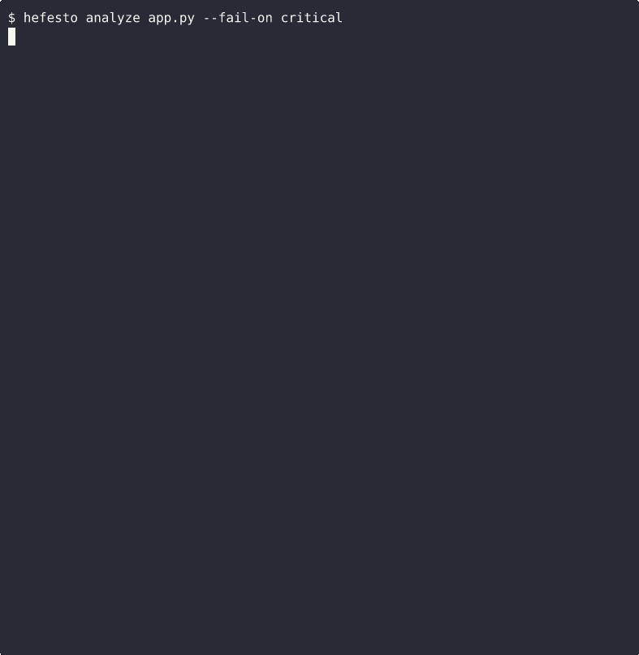

# HefestoAI — release truth engine for AI-generated code

**English** | [简体中文](README.zh-CN.md) | [日本語](README.ja.md)

<p align="center">
  
</p>

HefestoAI runs after your AI assistant writes the code and before it ships. It checks that what your project declares (dependencies, configs, install artifacts) matches what it actually does, and it runs security and complexity checks on the code itself.

[](https://pypi.org/project/hefesto-ai/)
[](https://www.python.org/downloads/)
[](LICENSE)
[](https://github.com/artvepa80/Agents-Hefesto)

### Quick start (GitHub Action)

**Deterministic pass/fail check for agent-written code.** It compares what your repo declares (dependencies, README, `pyproject.toml`, CHANGELOG, `action.yml`, CI) with what it actually does, and flags secrets and risky IaC. Same input, same result.

```yaml
# .github/workflows/hefesto.yml
name: HefestoAI
on: [pull_request, push]
permissions:
  contents: read
  security-events: write
jobs:
  hefesto:
    runs-on: ubuntu-latest
    steps:
      - uses: actions/checkout@v4
      - uses: artvepa80/Agents-Hefesto@v4
        with:
          fail_on: HIGH
          sarif: 'true'
```

Findings show up under **Security > Code scanning** and as pull request annotations. Public repositories work as shown; private repositories without GitHub Code Security set `upload_sarif: 'false'` (the SARIF file is still written). `@v4` follows every 4.x release, minors included (4.16.0 made a run that analyzes no files fail the gate). For a fixed version, pin `artvepa80/Agents-Hefesto@v4.20.0` or a commit SHA. The Action runs the same formats as `hefesto analyze`: Python plus YAML, Terraform, Shell, Dockerfile, SQL, PowerShell, JSON, TOML, Makefile, Groovy, COBOL, CloudFormation, ARM, Helm and Serverless, plus the drift checks. TypeScript, JavaScript, Java, Go, Rust and C# need the CLI with `pip install "hefesto-ai[multilang]"`.

Free and MIT. PRO ($8/mo) and OMEGA ($19/mo): [plans](https://hefestoai.narapallc.com/?utm_source=github&utm_medium=readme&utm_campaign=growth_q4_2026&utm_content=pricing_quickstart#pricing).

---

## Operational Truth Analyzers (v4.20.0)

These analyzers look for drift between what your project **declares** and what it **does**. They run on every `hefesto analyze`. The problems they look for don't live in any single file, so a per-file linter or security scanner won't report them: they show up only when you compare two files.

| Analyzer | What it catches | Rule ID |
|----------|----------------|---------|
| **Imports vs Deps** | Python imports not declared in `pyproject.toml` or `requirements.txt` | OT-IMPORTS-001 |
| **Docs vs Entrypoints** | CLI scripts in `[project.scripts]` missing from README | OT-DOCS-001 |
| **Packaging Parity** | Version mismatch between `pyproject.toml`, CHANGELOG, and README badges | OT-PKG-001/002 |
| **Install Artifact Parity** | `action.yml` inputs not consumed; `Dockerfile` COPY sources missing | OT-INSTALL-001/002 |
| **CI Config Drift** | Python version or flake8 config mismatch between local and CI workflow | OT-CI-001/002/003 |

```bash
# All operational truth findings appear in standard output
hefesto analyze . --severity MEDIUM
```

---

## Quick Start

```bash
pip install hefesto-ai
cd your-project
hefesto analyze . --fail-on critical

# PR review (added in v4.10.0) — analyze only changed code
hefesto pr-review
hefesto pr-review --strict        # include file-level context
hefesto pr-review --post --pr 42  # post inline comments via gh CLI
```

---

## Why Hefesto? The AI Code Problem

Assistants such as Claude Code, GitHub Copilot and Cursor write code faster than anyone can review it line by line. Some of what they write passes a linter and is still dangerous:

- `os.system(user_input)` → **command injection**
- `f"SELECT * FROM {table}"` → **SQL injection**
- code that runs but quietly changes behavior, such as a misspelled attribute or an exception that is caught and dropped (checked in Python)

Hefesto checks for these at pre-commit, at pre-push and in CI, so they surface before the code reaches production.

---

## What Hefesto Catches

| Issue | Severity | Description |
|-------|----------|-------------|
| HARDCODED_SECRET | CRITICAL | API keys, passwords in code |
| SQL_INJECTION_RISK | HIGH | String concatenation in queries |
| COMMAND_INJECTION | HIGH | Unsafe shell command execution |
| PICKLE_USAGE | HIGH | `pickle` / `cPickle` imports (unsafe deserialization) |
| UNDECLARED_DEPENDENCY | MEDIUM | Import used but not in pyproject.toml |
| PACKAGING_VERSION_DRIFT | MEDIUM | Version mismatch across pyproject/CHANGELOG/README |
| CI_CONFIG_DRIFT | MEDIUM-HIGH | Local env vs CI configuration mismatch |
| INSTALL_ARTIFACT_DRIFT | MEDIUM-HIGH | action.yml inputs or Dockerfile COPY out of sync |
| HIGH_COMPLEXITY | HIGH | Cyclomatic complexity > 10 |
| DEEP_NESTING | HIGH | Nesting depth > 4 levels |
| GOD_CLASS | HIGH | Classes > 500 lines |
| LONG_FUNCTION | MEDIUM | Functions > 50 lines |
| LONG_PARAMETER_LIST | MEDIUM | Functions with > 5 parameters |

```python
# Hefesto catches:
password = "admin123"  # HARDCODED_SECRET
query = f"SELECT * FROM users WHERE id={id}"  # SQL_INJECTION_RISK
os.system(f"rm {user_input}")  # COMMAND_INJECTION

# Hefesto suggests:
password = os.getenv("PASSWORD")
cursor.execute("SELECT * FROM users WHERE id=?", (id,))
subprocess.run(["rm", user_input], check=True)
```

---

## GitHub Action

```yaml
steps:
  - uses: actions/checkout@v4
  - name: Run Hefesto Guardian
    uses: artvepa80/Agents-Hefesto@v4
    with:
      target: '.'
      fail_on: 'CRITICAL'
```

`@v4` is a floating tag that follows the whole 4.x line, minor releases included: every v4.x.y release moves it, so the workflow gets fixes without edits, and also behaviour changes such as the 4.16.0 change that makes a run with no analyzed files fail `--fail-on` (exit 1; `--allow-no-files` opts out). If you need exact stability, pin an exact release tag such as `artvepa80/Agents-Hefesto@v4.20.0` (exact tags never move) or a commit SHA, and bump it yourself.

With SARIF upload to GitHub code scanning (findings appear under **Security > Code scanning** and as pull request annotations):

```yaml
jobs:
  hefesto:
    runs-on: ubuntu-latest
    permissions:
      contents: read
      security-events: write   # upload-sarif
      actions: read            # private repositories only
    steps:
      - uses: actions/checkout@v4
      - uses: artvepa80/Agents-Hefesto@v4   # SARIF needs v4.15.0 or later
        with:
          target: '.'
          fail_on: 'CRITICAL'
          sarif: 'true'
```

The Action is a composite action: it installs HefestoAI from the Action's own checkout into a private virtualenv (needs `python3` >= 3.10 on the runner; `ubuntu-latest` has it), runs `hefesto analyze`, and with `sarif: 'true'` uploads the SARIF file with `github/codeql-action/upload-sarif@v4`, also when the `fail_on` gate fails. Full reference: [docs/github-action.md](docs/github-action.md).

**Inputs**:

| Input | Description | Default |
|-------|-------------|---------|
| `target` | Path to analyze (file or directory) | `.` |
| `fail_on` | Exit with error if issues found at or above this severity level | `CRITICAL` |
| `allow_no_files` | `true`: passes `--allow-no-files`, so a run that analyzes no files keeps exit 0 under `fail_on` (intentionally empty target); the warning is still printed | `false` |
| `allow_not_analyzed` | `true`: passes `--allow-not-analyzed`, so a found file that could not be analyzed does not fail `fail_on`; the file is still listed as "Not analyzed" and warned about | `false` |
| `min_severity` | Minimum severity to report (`CRITICAL`, `HIGH`, `MEDIUM`, `LOW`) | `LOW` |
| `format` | Output format printed to the log (`text`, `json`, `html`, `sarif`) | `text` |
| `sarif` | `true`: also write a SARIF 2.1.0 file and upload it to code scanning (needs `security-events: write`) | `false` |
| `sarif_file` | Path of the SARIF file | `hefesto.sarif` |
| `upload_sarif` | With `sarif: true`, upload the file; `false` only writes it | `true` |
| `sarif_category` | Code scanning category of the upload | `hefesto` |
| `telemetry` | Opt-in. Only `1` or `true` enables telemetry: the Action sends one anonymous ping per run and the CLI sends its usage events. Any other value, including the default `0`, sends nothing; see [docs/telemetry.md](https://github.com/artvepa80/Agents-Hefesto/blob/main/docs/telemetry.md) | `0` |

**Outputs**:

| Output | Description |
|--------|-------------|
| `exit_code` | The exit code of the CLI (0 = threshold not breached, 1 = `fail_on` threshold breached or runtime error; see [Exit Codes](#exit-codes)) |
| `sarif_file` | Path of the SARIF file, when `sarif` is `true` and the file was written |

---

## AI-Generated Code Guardrails (Pre-commit + MCP)

HefestoAI can run as a pre-commit check or be called by an AI agent over MCP, so risky changes are flagged before merge.

**Add as an MCP server:**
```bash
npx @smithery/cli@latest mcp add artvepa80/hefestoai
```

**API Endpoints:**

| Endpoint | Protocol | Path |
|----------|----------|------|
| MCP | JSON-RPC 2.0 | `/api/mcp-protocol` |
| Hosted analysis | HTTP POST | `/api/analyze` |
| REST | HTTP GET/POST | `/api/mcp` |
| OpenAPI | OpenAPI 3.0 | `/api/openapi.json` |
| Q&A | Natural Language | `/api/ask` |
| Changelog | JSON | `/api/changelog.json` |
| FAQ | JSON | `/api/faq.json` |

The MCP `analyze` tool (and `POST /api/analyze`) runs the open-source engine (`hefesto analyze --no-config`, hefesto-ai 4.19.0) on the files you send: at most 20 files, 100 KB each, 256 KB in total, 20 seconds. It returns findings with rule ids, severities, lines and SARIF fingerprints. TypeScript, JavaScript, Java, Go, Rust and C# are covered too (`multilang` grammars; the first such request on a fresh server instance is a few seconds slower). Nothing is stored. For a whole repository, run `hefesto analyze .` locally.

The hosted MCP server is closed-source and operated by Narapa LLC. `server.json` keeps `repository` on this public repository because it contains the open-source `hefesto-ai` engine that `analyze` runs.

---

## PR Review (v4.20.0)

Analyze only the code changed in a pull request and post inline comments on the changed lines. Each finding carries a deterministic dedup key, so a workflow can skip findings it has already posted (the deduped template below does this; the simple one does not).

```bash
# Generate review as JSON (default — no network, no token needed)
hefesto pr-review

# Post inline comments via gh CLI (convenience mode)
hefesto pr-review --post --pr 42 --repo owner/name

# Include file-level context findings (not just changed lines)
hefesto pr-review --strict
```

**How it works:**
1. Parses `git diff` between base and head (auto-detects `origin/main` or `GITHUB_BASE_REF`)
2. Runs the full analyzer suite on touched files only
3. Filters findings to changed lines (default) or full files (`--strict`)
4. Emits JSON with SHA256 dedup keys for each finding

**GitHub Actions workflow templates** are provided under [`examples/github-actions/`](examples/github-actions/):

| Template | Use case | Idempotent? |
|----------|----------|-------------|
| `hefesto-pr-review-simple.yml` | Quick onboarding, small repos | No (reruns duplicate) |
| `hefesto-pr-review-deduped.yml` | Production CI, teams | Yes (jq dedup pipeline) |

See [`examples/github-actions/README.md`](examples/github-actions/README.md) for setup instructions.


---

## Language Support

### Code Languages

| Language | Parser | Status |
|----------|--------|--------|
| Python | Native AST | Full support |
| TypeScript | TreeSitter | Supported¹ |
| JavaScript | TreeSitter | Supported¹ |
| Java | TreeSitter | Supported¹ |
| Go | TreeSitter | Supported¹ |
| Rust | TreeSitter | Supported¹ |
| C# | TreeSitter | Supported¹ |

¹ TreeSitter languages require the `[multilang]` extra:
`pip install "hefesto-ai[multilang]"`. Without it, files in these
languages are skipped at parse time and Hefesto emits a stderr warning
pointing to the install command (also exposed via
`report.meta.parser_failures` in JSON output).

### DevOps & Configuration

| Format | Analyzer | Rules | Status | Run by `hefesto analyze` |
|--------|----------|-------|--------|---------------------------|
| **YAML** | YamlAnalyzer | Generic YAML security | v4.4.0 | Yes |
| **Terraform** | TerraformAnalyzer | TfSec-aligned rules | v4.4.0 | Yes |
| **Shell** | ShellAnalyzer | ShellCheck-aligned | v4.4.0 | Yes |
| **Dockerfile** | DockerfileAnalyzer | Hadolint-aligned | v4.4.0 | Yes |
| **SQL** | SqlAnalyzer | SQL Injection prevention | v4.4.0 | Yes |
| **PowerShell** | PS001-PS006 | 6 security rules | v4.5.0 | Yes |
| **JSON** | J001, J002, J004, J005 | 4 security rules | v4.5.0 | Yes |
| **TOML** | T001-T003 | 3 security rules | v4.5.0 | Yes |
| **Makefile** | MF001-MF005 | 5 security rules | v4.5.0 | Yes |
| **Groovy** | GJ001-GJ005 | 5 security rules | v4.5.0 | Yes |
| **COBOL** | CobolGovernanceAnalyzer | COBOL001-COBOL016 (16 free rules)² | v4.12.0 | Yes |

### Cloud Infrastructure

| Format | Analyzer | Focus | Status | Run by `hefesto analyze` |
|--------|----------|-------|--------|---------------------------|
| **CloudFormation** | CloudFormationAnalyzer | AWS IaC Security | v4.7.0 | Yes |
| **ARM Templates** | ArmAnalyzer | Azure IaC Security | v4.7.0 | Yes |
| **Helm Charts** | HelmAnalyzer | Kubernetes Security | v4.7.0 | Yes |
| **Serverless** | ServerlessAnalyzer | Serverless Framework | v4.7.0 | Yes |

**Total**: the package ships analyzers for 22 formats (7 code languages + 11 DevOps formats + 4 Cloud formats). `hefesto analyze` (which the GitHub Action and the pre-push hook call) runs all 22. When a suffix matches more than one format, the precedence table in [docs/design/devops-analyzers-wiring.md](https://github.com/artvepa80/Agents-Hefesto/blob/main/docs/design/devops-analyzers-wiring.md) chooses one analyzer.

² COBOL: all 16 rules are free; no license is needed. The analyzer is regex-based (no full COBOL parser) and reads `.cbl`, `.cob`, `.cobol`, `.cpy` and `.pco` files (lower or upper case), plus `.dcl`, `.copy`, `.cbk` and extension-less files that a scanned program `COPY`s or `EXEC SQL INCLUDE`s and that hold COBOL data definitions (copybooks get only the data rules COBOL004/COBOL008/COBOL009/COBOL016, COBOL007 and COBOL015 for their own nested `COPY`s; the other rules are not applied to them).

COBOL details (source format, per-rule behaviour, COPY expansion, measured recall, performance, SARIF): [docs/cobol.md](https://github.com/artvepa80/Agents-Hefesto/blob/main/docs/cobol.md).

---

## Installation

```bash
# FREE tier
pip install hefesto-ai

# Required for TypeScript, JavaScript, Java, Go, Rust, and C# analysis
pip install "hefesto-ai[multilang]"

# Optional: Black, for `hefesto analyze --format-check`
pip install "hefesto-ai[format]"
```

`pip install hefesto-ai` installs the FREE tier only. For PRO or OMEGA, Narapa sends you an activation code after purchase, and the activation instructions come with it.

---

## CLI Reference (v4.20.0)

```bash
# Analyze code
hefesto analyze <path>
hefesto analyze . --severity HIGH
hefesto analyze . --output json
hefesto analyze . --format sarif > hefesto.sarif   # SARIF 2.1.0 (--format is an alias of --output)
hefesto analyze . --sarif-file hefesto.sarif       # text report + SARIF file
hefesto analyze . --format-check   # opt-in: also report Black formatting drift
hefesto analyze . --config ci/hefesto.yaml    # explicit config file (see Configuration)
hefesto analyze . --no-config                 # ignore .hefesto.yaml
hefesto analyze src/ --copybook-path ../copylib  # COBOL copybooks outside the scan
hefesto analyze . --include-vendored  # also analyze vendored/minified JS (skipped by default)

# PR review (added in v4.10.0)
hefesto pr-review                              # JSON to stdout
hefesto pr-review --base main --head HEAD      # explicit refs
hefesto pr-review --strict                     # file-level findings too
hefesto pr-review --post --pr 42 --repo o/r    # post via gh CLI

# Check status
hefesto status

# Install/update git hook
hefesto install-hooks

# Start API server (PRO)
hefesto serve --port 8000

# Telemetry (on by default)
hefesto telemetry disable
```

### JSON Output
```bash
hefesto analyze . --output json          # stdout = pure JSON, banners -> stderr
hefesto analyze . --output json 2>/dev/null | jq .  # pipe-safe
```

### SARIF Output
```bash
hefesto analyze . --format sarif > hefesto.sarif   # stdout = pure SARIF, banners -> stderr
hefesto analyze . --sarif-file out/hefesto.sarif   # any --output, plus a SARIF file
```

SARIF 2.1.0 for every finding `hefesto analyze` reports (all analyzers it runs, COBOL included, plus Operational Truth and provider findings), validated against the OASIS schema in the tests:

- one rule per rule ID (`COBOL004`, `DOCKER010`, ...; the issue type such as `HARDCODED_SECRET` when an analyzer has no ID) with name, description, help, help URI and a default level;
- `level`: CRITICAL/HIGH -> `error`, MEDIUM -> `warning`, LOW -> `note`; security rules (secrets, injection, unsafe commands, ...) also get `security-severity` (9.5 / 8.0 / 5.5 / 3.0), so GitHub rates them Critical/High/Medium/Low, plus CWE tags when known;
- repo-relative URIs (`%SRCROOT%`, the git top level of the current directory) and `partialFingerprints` built from the rule, the file and the text of the flagged line, so alerts keep their identity when code above them moves;
- GitHub upload limits: at most 25,000 results (highest severity kept) and 10 MB gzipped; anything dropped is reported in the log's tool notifications.

Columns are not reported (start line only).

### Formatting Drift (opt-in)

`hefesto analyze` does not check formatting by default. With `--format-check`
it also runs [Black](https://github.com/psf/black) in check mode (in-process,
files are never modified) on the Python files it analyzed:

```bash
pip install "hefesto-ai[format]"                    # or: pip install black
hefesto analyze . --format-check                    # report drift
hefesto analyze . --format-check --fail-on LOW      # fail the gate on drift
```

- Each file Black would reformat is one `FORMAT_DRIFT` finding, severity LOW.
  Because the check is opt-in, these findings are shown even when
  `--severity` is above LOW. `--fail-on` and `--exclude-types` apply to them
  like any other finding, so `--fail-on MEDIUM` (or higher) does not trip on drift.
- Black settings come from your `pyproject.toml` `[tool.black]` table, found
  the same way the `black` CLI finds it (line-length, target-version,
  skip-string-normalization, preview, `extend-exclude` / `force-exclude`, ...).
  If `required-version` does not match the installed Black, Hefesto warns.
- JSON output carries a unified diff (first 60 lines) in `code_snippet` and
  `lines_added` / `lines_removed` in `metadata`.
- If Black is not installed, Hefesto prints a one-line warning and continues;
  the exit code is unaffected.
- Only Black is covered; isort and flake8 are not run.

### Exit Codes

| Code | Meaning |
|------|---------|
| `0`  | Analysis complete (no `--fail-on`, or threshold not breached) |
| `1`  | Gate failure (`--fail-on` threshold breached, or no file was analyzed under `--fail-on`) or runtime error |
| `2`  | Invalid command-line usage or invalid `.hefesto.yaml` |

### Gate Examples
```bash
hefesto analyze . --fail-on high         # exit 1 if HIGH+ found
hefesto analyze . --fail-on critical     # exit 1 only if CRITICAL found
hefesto analyze .                        # always exit 0 (report only)
hefesto analyze . --fail-on high --allow-no-files   # an empty run keeps exit 0
hefesto analyze . --fail-on high --allow-not-analyzed  # a file that failed does not fail the gate
```

A run that analyzes no files (empty directory, only unsupported files, or every
file excluded) is never reported as a pass: the report says "No files were
analyzed", a warning naming the path goes to stderr, and with `--fail-on` the
gate fails with exit 1. When files were left out as vendored JavaScript, the
warning names how many and suggests `--include-vendored`.

For runs that are empty on purpose (a changed-files-only job on a PR that
touches only Markdown, a monorepo matrix entry with no supported sources), pass
`--allow-no-files` (the Action's `allow_no_files: 'true'` input passes it for
you). Only the exit code changes: the run keeps exit 0 and prints "Gate
skipped: no files were analyzed (--allow-no-files)", while "Files analyzed: 0",
"No files were analyzed" and the stderr warning are still printed. It is a
command-line flag only: `.hefesto.yaml` cannot set it (an `allow_no_files` key
is rejected as unknown, exit 2), so a shared config never turns this check off.

A file the run found but could not analyze (it is not valid UTF-8, or its
analyzer raised an error) is never dropped silently: the text report lists it
under "Not analyzed" with the reason, `--output json` has it in
`meta.not_analyzed` (`path`, `language`, `reason`: `read_error` or
`analyzer_error`, `exception`), SARIF has an `error` notification for it in
`invocations[0].toolExecutionNotifications`, and a warning goes to stderr (also
with `--quiet`). With `--fail-on` such a file fails the gate with "Gate failure:
N file(s) could not be analyzed (exit 1)", also when `--allow-no-files` is set.
`--allow-not-analyzed` (the Action's `allow_not_analyzed: 'true'` input) opts
out: the gate then judges only the findings, and the file is still listed and
warned about. Like `--allow-no-files`, it is a command-line flag only.

---

## Pre-Push Hook

> In your own project, `hefesto install-hooks` installs the hooks shipped with the package: pre-commit analyzes the staged files (`--fail-on HIGH`), pre-push analyzes the repository (`--fail-on CRITICAL`). The hooks call the Python interpreter that ran `install-hooks` (`python -m hefesto`), fall back to `hefesto` on PATH, and fail with a message if neither is found (reinstall the hooks or set `SKIP_HEFESTO_HOOKS=1`). The hooks go to `git rev-parse --git-path hooks`, so worktrees and submodules work; if `core.hooksPath` is set (Husky, lefthook...), nothing is written and the command exits 1: call `python -m hefesto analyze` from that hook manager or use the `hefesto-analyze` pre-commit framework hook (see [pre-commit Hook](#pre-commit-hook)). It also exits 1 when no hook was installed (for example, existing hooks without `--force`). Limitation: the pre-commit hook analyzes the working-tree copy of the staged files, not the staged (index) content. The contributor hooks from `scripts/git-hooks/` described below are used only in a clone of Agents-Hefesto (root `pyproject.toml` with `name = "hefesto-ai"`); the command says which set it installed.

Automatic validation before every `git push` in this repository:

```bash
# Install the same hooks and print the plans link (PRO $8/mo, OMEGA $19/mo)
hefesto init

# Install/update hook (copies scripts/git-hooks/pre-push -> .git/hooks/pre-push)
hefesto install-hooks

# Update an existing hook
hefesto install-hooks --force

# Bypass temporarily
SKIP_HEFESTO_HOOKS=1 git push
```

The hook runs two gates:

1. **Security gate** — `hefesto analyze` with `--fail-on CRITICAL --exclude-types VERY_HIGH_COMPLEXITY,LONG_FUNCTION` (blocks security issues, ignores complexity debt)
2. **Fast lint/test gate** — Black, isort, Flake8, and a minimal test suite

> **Note:** Hooks are local to your machine and not committed to git. Run `hefesto install-hooks` after cloning or whenever `scripts/git-hooks/pre-push` is updated.

---

## Features by Tier

| Feature | FREE | PRO ($8/mo) | OMEGA ($19/mo) |
|---------|------|-------------|----------------|
| Static Analysis | Yes | Yes | Yes |
| Security Scanning | Basic | Advanced | Advanced |
| Pre-push Hooks | Yes | Yes | Yes |
| Language & format support ([details](#language-support)) | Yes | Yes | Yes |
| ML Enhancement | No | Yes | Yes |
| REST API | No | Yes | Yes |
| BigQuery Analytics | No | Yes | Yes |
| IRIS Monitoring | No | No | Yes |
| Production Correlation | No | No | Yes |

- **PRO** ($8/mo) and **OMEGA** ($19/mo): [plans and checkout](https://hefestoai.narapallc.com/?utm_source=github&utm_medium=readme&utm_campaign=growth_q4_2026&utm_content=pricing_features_by_tier#pricing)

### Hefesto PRO Optional Features

Hefesto OSS works standalone. If Hefesto PRO is installed, OSS can optionally enable:
Patch C API hardening for `hefesto serve`, scope gating (first-party by default), TS/JS
symbol discovery, and safe deterministic enrichment (schema-first, masked, bounded).
See [`docs/PRO_OPTIONAL_FEATURES.md`](docs/PRO_OPTIONAL_FEATURES.md).

---

## REST API (PRO), OMEGA Guardian and IRIS

`hefesto serve` (PRO) exposes the analyzer over HTTP: [docs/rest-api.md](https://github.com/artvepa80/Agents-Hefesto/blob/main/docs/rest-api.md). OMEGA Guardian and the IRIS production-monitoring agent: [docs/omega-iris.md](https://github.com/artvepa80/Agents-Hefesto/blob/main/docs/omega-iris.md).

---

## CI/CD Integration

### GitHub Actions — Full Repo Analysis

```yaml
name: Hefesto

on: [push, pull_request]

jobs:
  analyze:
    runs-on: ubuntu-latest
    steps:
      - uses: actions/checkout@v4
      - name: Install Hefesto
        run: pip install hefesto-ai
      - name: Run Analysis
        run: hefesto analyze . --severity HIGH
```

### GitHub Actions — Code Scanning (SARIF) with the CLI

```yaml
jobs:
  analyze:
    runs-on: ubuntu-latest
    permissions:
      contents: read
      security-events: write
    steps:
      - uses: actions/checkout@v4
      - run: pip install hefesto-ai
      - run: hefesto analyze . --severity LOW --fail-on CRITICAL --sarif-file hefesto.sarif
      - if: always()
        uses: github/codeql-action/upload-sarif@v4
        with:
          sarif_file: hefesto.sarif
          category: hefesto
```

### GitHub Actions — PR Review with Inline Comments (v4.20.0)

```yaml
name: Hefesto PR Review

on:
  pull_request:
    types: [opened, synchronize, reopened]

permissions:
  contents: read
  pull-requests: write

jobs:
  review:
    runs-on: ubuntu-latest
    steps:
      - uses: actions/checkout@v4
        with:
          fetch-depth: 0
      - run: pip install hefesto-ai
      - name: Review changed code
        env:
          GITHUB_BASE_REF: ${{ github.event.pull_request.base.ref }}
          GITHUB_SHA: ${{ github.event.pull_request.head.sha }}
          GH_TOKEN: ${{ secrets.GITHUB_TOKEN }}
        run: hefesto pr-review --post --pr ${{ github.event.pull_request.number }} --repo ${{ github.repository }}
```

> For production use with dedup (no duplicate comments on reruns), see the workflow templates in [`examples/github-actions/`](examples/github-actions/).

### pre-commit Hook

```yaml
# .pre-commit-config.yaml
repos:
  - repo: https://github.com/artvepa80/Agents-Hefesto
    rev: v4.20.0
    hooks:
      - id: hefesto-analyze
```

### GitLab CI

```yaml
hefesto:
  stage: test
  script:
    - pip install hefesto-ai
    - hefesto analyze . --severity HIGH
```

---

## Configuration

`hefesto analyze` takes its options from command-line flags (see CLI
Reference above) and, optionally, from a `.hefesto.yaml` file (below). There
is no environment variable for analysis options such as severity or output
format.

### Environment Variables

```bash
# Telemetry (see Telemetry below)
export HEFESTO_TELEMETRY=0                            # Disable anonymous usage events

# PRO/OMEGA only (read by the private distribution, ignored by the FREE tier)
export HEFESTO_LICENSE_KEY="your-key"

# API Security (PRO, v4.7.0) -- used by `hefesto serve`
export HEFESTO_API_KEY="your-api-key"                # Enable API key auth
export HEFESTO_RATE_LIMIT_PER_MINUTE=60               # Enable rate limiting
export HEFESTO_CORS_ORIGINS="https://app.example.com" # Restrict CORS
export HEFESTO_EXPOSE_DOCS=1                          # Enable /docs, /redoc
export HEFESTO_WORKSPACE_ROOT="/srv/code"              # Path sandbox root
export HEFESTO_CACHE_MAX_SIZE=1000                     # Cache size limit
export HEFESTO_CACHE_TTL_SECONDS=300                   # Cache entry TTL
```

### Config File (`.hefesto.yaml`)

Put the `hefesto analyze` options you would otherwise repeat on every run in a
`.hefesto.yaml` (or `.hefesto.yml`) file, usually at the repository root:

```yaml
# .hefesto.yaml -- every key is optional and maps to a `hefesto analyze` flag
severity: MEDIUM            # --severity      LOW | MEDIUM | HIGH | CRITICAL
fail_on: HIGH               # --fail-on       LOW | MEDIUM | HIGH | CRITICAL
output: text                # --output        text | json | html
exclude:                    # --exclude       list or "a/,b/" string
  - tests/
  - node_modules/
exclude_types:              # --exclude-types list or comma-separated string
  - VERY_HIGH_COMPLEXITY
  - LONG_FUNCTION
quiet: false                # --quiet
max_issues: 50              # --max-issues
format_check: true          # --format-check  (needs: pip install "hefesto-ai[format]")
enable_memory_budget_gate: false  # --enable-memory-budget-gate
copybook_paths:             # --copybook-path (COBOL copybook directories outside the scan)
  - ../copylib              # relative paths are resolved from this file's directory
include_vendored: false     # --include-vendored (analyze vendored/minified JavaScript too)
```

- **Excluded by default:** `.venv/`, `venv/`, `.tox/`, `node_modules/`,
  `.git/`, `__pycache__/`, `dist/`, `build/`, `.mypy_cache/`,
  `.pytest_cache/`, `.eggs/`, `*.egg-info/` (whole path components below the
  analyzed path), plus vendored and minified JavaScript (`.js`, `.mjs`,
  `.cjs`): `*.min.js` / `*-min.js` files, files under `vendor/`, `vendors/`,
  `bower_components/` or `jspm_packages/`, and files under a `lib/`, `libs/`,
  `plugins/`, `third_party/` or `thirdparty/` directory inside `static/`,
  `assets/`, `public/` or `wwwroot/` (for example `static/js/libs/jquery.js`).
  A top-level `lib/` is the project's own code and stays in scope, as do
  non-JavaScript files under `vendor/` (Go, PHP). `--include-vendored` (or
  `include_vendored: true`) analyzes the JavaScript ones again; a single file
  given on the command line is always analyzed.
  The summary says how many were left out (`N files skipped as vendored (use
  --include-vendored)`; `meta.vendored_skipped` in JSON, a tool notification in
  SARIF).

- **Discovery:** Hefesto starts at the first path given to `hefesto analyze`
  (its directory if it is a file) and walks up to the repository root (the
  first directory containing `.git`), or to the filesystem root outside a
  repo. The nearest file wins. Both `.hefesto.yaml` and `.hefesto.yml` in one
  directory is an error. With several paths, the first path's config applies
  to the whole run (Hefesto warns if another path would pick a different file).
- **Precedence:** explicit flag > config file > built-in default. A flag
  counts as explicit even when it repeats the default (`--severity MEDIUM`
  overrides `severity: LOW`). Lists are replaced, not merged:
  `--exclude docs/` ignores the file's `exclude`.
- **Flags:** `--config PATH` uses that file instead of searching;
  `--no-config` ignores config files. They cannot be combined.
- **Validation:** unknown keys, bad values and invalid YAML stop the run with
  exit code 2 and a message naming the problem, e.g.
  `Error: invalid Hefesto config in /repo/.hefesto.yaml: 'severity' must be one of LOW, MEDIUM, HIGH, CRITICAL (got 'urgent')`.
  Keys may use `-` or `_` (`fail-on` or `fail_on`); `null` means "not set".
- The file in use is printed as `Config: <path>` (to stderr with
  `--output json`; hidden with `--quiet`).
- Only `hefesto analyze` reads it (not `pr-review` or the GitHub Action
  inputs). Rule thresholds (cyclomatic complexity, etc.), `--save-html` and
  the PRO scope/enrichment flags are not configurable through the file.

---

## vs. Competition

| Criterion | Hefesto | Semgrep | CodeRabbit | Qodo | Snyk |
|---|---|---|---|---|---|
| **AI-generated code focus** | ✅ Primary use case | Generic | ✅ Yes | ✅ Yes | Generic |
| **Declared-vs-real drift detection** | ✅ Core feature | ❌ | ❌ | ❌ | ❌ |
| **Operational truth analyzers** | ✅ 5 analyzers | ❌ | ❌ | ❌ | ❌ |
| **Languages supported** | 22 formats analyzed by the CLI ([details](#language-support)) | Many | Many | Many | Many |
| **Setup time** | < 5 min, no config | Config-heavy | Cloud signup | Cloud signup | Cloud signup |
| **Where it runs** | Local CLI / GitHub Action / pre-commit / MCP | Local / cloud | Cloud only | Cloud only | Cloud / CLI |
| **Pricing (as of Oct 2026)** | Free OSS / $8/mo PRO / $19/mo OMEGA | Free tier / Teams $30/contributor/mo (Code)\* | Free for public repos / $24/dev/mo (annual) | Credit-based, $0.012/credit; no permanent free plan | Free / Team $25/mo\*\* |

\*Semgrep Supply Chain and Secrets are priced separately. \*\*Snyk Team covers up to 10 developers; Enterprise is credit-based. Prices from each vendor's official pricing page, checked Oct 2026; they change often.

**Where HefestoAI fits:** most tools check code against the rules of its language. HefestoAI also checks a project against its own declarations: whether the imports match the declared dependencies, whether the versions in `pyproject.toml`, the CHANGELOG and the README agree, and whether `action.yml` and the Dockerfile match the files they reference.

---

## Dogfooding (Honest Account)

We run HefestoAI's strict gate against HefestoAI's own code on every push to main. The gate has been GREEN since 2026-04-29, and getting there took more than six weeks: we logged the findings on 2026-03-17.

In strict mode, the gate flagged 12 complexity findings in our own gate-internals code (2 CRITICAL, 10 HIGH). We considered three responses: silence the findings (rejected — that's exactly the drift we critique), accept the override permanently (rejected — same reason), or refactor at root cause (chosen). The root-cause refactor itself was short once we started it: one PR, written over two days (2026-04-27 and 04-28) and merged on 2026-04-29. Along the way we also found a declared-vs-real drift in our own positioning doc and logged it for a fix.

The full audit and refactor history are tracked internally in our private repo. The refactor took the two CRITICAL functions from cyclomatic complexity 33 → 1 and 25 → 6, all helpers under 10. The 10 HIGH findings are under a temporary override whose mechanics and reversion criteria are documented.

---

## Telemetry

The CLI sends anonymous usage events by default (a random id; `analyze` also sends file and issue counts, duration, exit code, version, OS, Python, and ci/docker/dogfood plus pypi or editable — no code, file paths, findings, repository names, or IP). Turn it off with `hefesto telemetry disable`, HEFESTO_TELEMETRY=0, or DO_NOT_TRACK=1. The GitHub Action sends nothing unless you set telemetry: 1. Details: [docs/telemetry.md](https://github.com/artvepa80/Agents-Hefesto/blob/main/docs/telemetry.md).

## Changelog

Release history: [CHANGELOG.md](https://github.com/artvepa80/Agents-Hefesto/blob/main/CHANGELOG.md).

---

## Contact

- **Enterprise & licensing**: sales@narapallc.com
- **Support & bug reports**: support@narapallc.com
- **General inquiries**: contact@narapallc.com
- **GitHub Issues**: [artvepa80/Agents-Hefesto/issues](https://github.com/artvepa80/Agents-Hefesto/issues)
- **Website**: [hefestoai.narapallc.com](https://hefestoai.narapallc.com/?utm_source=github&utm_medium=readme&utm_campaign=growth_q4_2026&utm_content=website_contact)

## License

The code in this repository is licensed under the [MIT License](LICENSE). The paid PRO and OMEGA features (the separately distributed `hefesto_pro` add-on) are covered by separate commercial terms in [LICENSE-COMMERCIAL.md](LICENSE-COMMERCIAL.md). Questions about licensing: sales@narapallc.com.

---

(c) 2026 Narapa LLC, Miami, Florida
